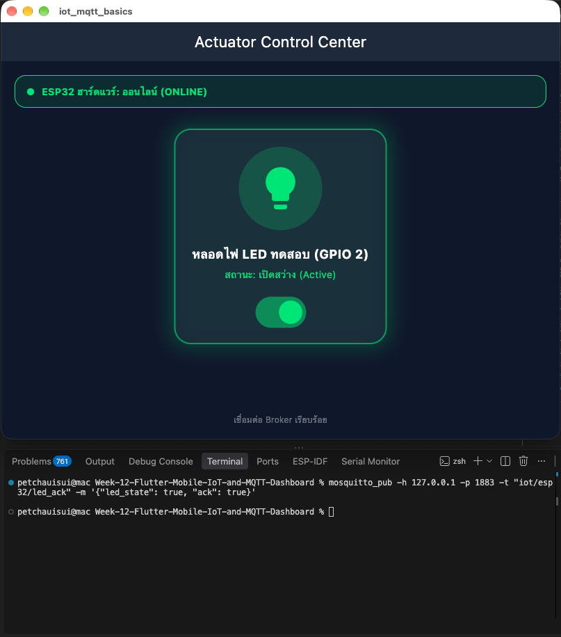

# ใบงานการทดลองที่ 12.1 การติดตั้งสภาพแวดล้อม Flutter และการพัฒนา MQTT Client พื้นฐานบนสมาร์ตโฟน

## กิจกรรมที่ 12-1.3: การทดสอบร่วมกับ Mosquitto CLI
1. เปิด Mosquitto Broker บนเครื่องคอมพิวเตอร์
```
mosquitto -v -p 1883
```
#### ผลการทดสอบ


### 4. ทดสอบส่งข้อความสองทาง
- บนหน้าจอ Flutter: กรอก IP เป็น 127.0.0.1 (หรือ IP ของ Broker ที่เปิดรับ) แล้วกดปุ่ม Connect
- เมื่อสถานะเปลี่ยนเป็นสีเขียว ให้กดปุ่ม Publish Test Message
- สังเกตหน้าต่าง PowerShell mosquitto_sub ว่าได้รับข้อความ Ping หรือไม่
- ในอีกหน้าต่าง PowerShell ส่งข้อความตอบกลับไปยังหัวข้อที่ Flutter รอฟัง:
```
mosquitto_pub -h 127.0.0.1 -p 1883 -t "test/broker/echo" -m "Echo response from CLI"
```
- ตรวจสอบว่าในช่อง Logs ของ Flutter App แสดงข้อความที่ได้รับอย่างถูกต้อง
#### ผลการทดสอบ
- **หน้าจอแอปพลิเคชัน Flutter (เชื่อมต่อสำเร็จ และ Publish Ping ข้อความไปยัง Broker):**


- **หน้าต่าง Terminal CLI (รันคำสั่ง mosquitto_sub ได้รับข้อความ Ping จาก Flutter):**


---

## 4. คำถามท้ายการทดลอง (Review Questions)

### 1. เพราะเหตุใดเราจึงต้องสุ่มชื่อ clientId เช่นการใส่ Timestamp ต่อท้าย แทนที่จะตั้งชื่อแบบคงที่?
**ตอบ** เพราะระบบ MQTT ตัวโบรกเกอร์จะยอมให้ client id ชื่อนั้นๆ เชื่อมต่อได้แค่เครื่องเดียวในเวลาเดียวกัน ถ้าเราตั้งชื่อฟิกไว้แล้วเผลอเปิดแอปซ้ำหรือมีคนเปิดพร้อมกัน โบรกเกอร์จะมองว่ามีเครื่องใหม่เข้ามาแย่ง session แล้วจะเตะเครื่องเก่าให้หลุดทันที ทำให้แอปหลุดวนไปมาเรื่อยๆ การสุ่มชื่อโดยเอาพวก timestamp หรือเวลาปัจจุบันมาต่อท้ายจะช่วยให้ชื่อไม่ซ้ำกัน เลยทำให้เชื่อมต่อพร้อมกันได้โดยไม่ตีกันเอง

### 2. หากหน้าจอ Flutter รันบนอุปกรณ์จริง (Physical Android Phone) เหตุใดการกรอก IP 127.0.0.1 จึงไม่สามารถเชื่อมต่อ Broker ได้? และต้องใช้ IP ใด?
**ตอบ** เพราะว่าเลข 127.0.0.1 มันคือ localhost ซึ่งหมายถึงตัวเครื่องโทรศัพท์มือถือเครื่องนั้นเอง ไม่ใช่เครื่องคอมพิวเตอร์ที่รัน Broker อยู่ พอมือถือพยายามเชื่อมต่อไปที่ 127.0.0.1 ในตัวเองแล้วไม่เจอบริการ MQTT มันก็เลยเชื่อมต่อไม่สำเร็จ
ถ้าจะต่อได้ ต้องเอามือถือกับคอมมาต่อ Wi-Fi เดียวกัน แล้วเปลี่ยนไปใช้เลข IPv4 ของเครื่องคอมพิวเตอร์ เช่น 192.168.1.xxx พร้อมทั้งเปิดไฟล์คอนฟิกของ mosquitto ให้ยอมรับการเชื่อมต่อจากอุปกรณ์ภายนอกด้วย

### 3. การตั้งค่า keepAlivePeriod มีความจำเป็นอย่างไรในสภาพแวดล้อมเครือข่ายไร้สาย?
**ตอบ** เวลาใช้งานผ่าน Wi-Fi หรือเน็ตมือถือ สัญญาณมันอาจจะหลุดหรือหายไปเฉยๆ โดยที่ตัวเครื่องไม่ได้ส่งสัญญาณไปบอกโบรกเกอร์ก่อนว่าขอตัดการเชื่อมต่อ การตั้งค่า keepAlivePeriod เลยจำเป็นมาก เพื่อให้เครื่องคอยส่ง ping ไปเช็คกับโบรกเกอร์เป็นรอบๆ ถ้าหายเงียบไปนานเกินเวลาที่กำหนด โบรกเกอร์จะได้รู้ว่าเครื่องหลุดไปแล้วจริงๆ จะได้อัปเดตสถานะและแจ้งเตือนคนอื่นผ่าน LWT ได้ทันที แล้วยังช่วยเลี้ยงการเชื่อมต่อไม่ให้เราเตอร์หรือไฟร์วอลล์ตัด session ทิ้งด้วย

# ใบงานการทดลองที่ 12.2 การสร้างสวิตช์ควบคุมอุปกรณ์สองทาง (Bi-directional Actuator Switch) พร้อมระบบ Feedback และสถานะ LWT


## กิจกรรมที่ 12-2.2: การทดสอบร่วมกับสคริปต์จำลองฮาร์ดแวร์ (Mock Simulation)

หากยังไม่ได้ต่อบอร์ด ESP32 จริง สามารถใช้ PowerShell ทดสอบจำลองพฤติกรรมของฮาร์ดแวร์ได้

1. จำลองส่งสถานะ Online (เสมือน ESP32 บูตเสร็จ)
```powershell
mosquitto_pub -h 127.0.0.1 -p 1883 -t "iot/esp32/status" -m "online" -r
```
*สังเกตหน้าจอ Flutter แถบสถานะด้านบนจะเปลี่ยนเป็นสีเขียวทันที*

#### ผลการทดสอบ
- **หน้าจอแอปพลิเคชัน Flutter แสดงสถานะ ESP32 ฮาร์ดแวร์: ออนไลน์ (ONLINE):**


2. เฝ้าดูคำสั่งที่ส่งมาจากแอป Flutter
```powershell
mosquitto_sub -h 127.0.0.1 -p 1883 -t "iot/esp32/control" -v
```
*เมื่อแตะสวิตช์บน Flutter จะเห็นแพ็กเก็ต `{"led":"ON"}` หรือ `{"led":"OFF"}` ปรากฏในเทอร์มินัล*

#### ผลการทดสอบ
- **หน้าต่าง Terminal CLI (รันคำสั่ง mosquitto_sub ได้รับแพ็กเก็ตคำสั่งจากแอปพลิเคชัน Flutter):**


3. ส่งคำสั่งยืนยันกลับไปยังแอป (เสมือนบอร์ดเปลี่ยนสถานะขา GPIO สำเร็จ)
```powershell
mosquitto_pub -h 127.0.0.1 -p 1883 -t "iot/esp32/led_ack" -m '{"led_state": true, "ack": true}'
```
*สังเกตสวิตช์และไอคอนหลอดไฟบนมือถือจะเรืองแสงสีเขียวทันที*

#### ผลการทดสอบ
- **หน้าจอแอปพลิเคชัน Flutter ได้รับสัญญาณ ACK หลอดไฟเรืองแสงสีเขียว พร้อมเทอร์มินัล CLI ที่ส่งคำสั่งยืนยัน:**


4. จำลองเหตุการณ์บอร์ดดับหรือเน็ตหลุด (เสมือน Broker ส่ง LWT)
```powershell
mosquitto_pub -h 127.0.0.1 -p 1883 -t "iot/esp32/status" -m "offline" -r
```
*สังเกตว่าหน้าจอจะแจ้งเตือนว่า ESP32 ออฟไลน์ทันที และสวิตช์จะไม่ยอมให้สั่งการ*

#### ผลการทดสอบ
- **หน้าจอแอปพลิเคชัน Flutter แจ้งเตือนสถานะ ESP32 ฮาร์ดแวร์: ออฟไลน์ (OFFLINE):**


---

## 4. สรุปผลและคำถามท้ายการทดลอง

### 1. ประโยชน์ของการรอสัญญาณ ACK จากหัวข้อ `iot/esp32/led_ack` แทนการเปลี่ยน UI ทันที (Optimistic Update) คืออะไร?
**ตอบ** ช่วยให้สถานะบนหน้าจอมือถือตรงกับสถานะจริงของหลอดไฟที่บอร์ด ESP32 ถ้าเราใช้แบบเปลี่ยน UI ทันที (Optimistic Update) พอกดสวิตช์แล้วไฟบนจอจะติดเลย แต่ถ้าตอนนั้นเน็ตหลุดหรือบอร์ดค้าง ขา GPIO ไม่ได้เปิดจริง ผู้ใช้ก็จะเข้าใจผิดว่าไฟเปิดแล้ว การรอสัญญาณ ACK จึงช่วยยืนยันว่าฮาร์ดแวร์ปลายทางทำงานสำเร็จจริงๆ ก่อนที่หน้าจอจะเปลี่ยนสถานะตาม

### 2. ทำไมเราจึงควรตั้งแฟล็ก Retain (`-r`) สำหรับหัวข้อสถานะ `iot/esp32/status`?
**ตอบ** เพราะว่าแฟล็ก Retain จะสั่งให้โบรกเกอร์เก็บข้อความสถานะล่าสุดเอาไว้ในหน่วยความจำ พอมีแอปหรือ Client ตัวใหม่เพิ่งเปิดขึ้นมาและกด Subscribe หัวข้อนี้ โบรกเกอร์จะส่งสถานะล่าสุด (เช่น online หรือ offline) ให้แอปทันทีโดยไม่ต้องรอบอร์ดส่งมาใหม่ ทำให้หน้าจอแอปสามารถรู้ได้ตั้งแต่เปิดแอปเลยว่าตอนนี้บอร์ดกำลังออนไลน์หรือออฟไลน์อยู่

# ใบงานการทดลองที่ 12.3 การสร้างแดชบอร์ดแสดงผลเซนเซอร์เรียลไทม์ด้วย Radial Gauge และ Live Trend Line Chart

## กิจกรรมที่ 12-3.3: การทดสอบร่วมกับสคริปต์จำลองเซนเซอร์ (Telemetry Mock Simulation)

### 1. การทดสอบด้วยสคริปต์ Python Telemetry Simulator
สร้างและรันไฟล์สคริปต์ `pyTeleSim.py` เพื่อจำลองส่งคลื่นสัญญาณ Sine Wave ของแรงดันไฟฟ้า (0.0 ถึง 3.3V) ไปยัง Broker อย่างต่อเนื่อง:
```bash
python3 pyTeleSim.py
```

#### ผลการทดสอบ
- **หน้าจอแอปพลิเคชัน Flutter และเทอร์มินัลรัน pyTeleSim.py แสดงผลค่าแรงดันแบบเรียลไทม์ร่วมกับสัญญาณ Sine Wave:**


- **ภาพเคลื่อนไหวแสดงการทำงานของเข็ม Radial Gauge และกราฟคลื่น Sine ย้อนหลัง 30 ตัวอย่าง (Live Trend Sparkline):**


### 2. การทดสอบแบบเจาะจงค่าผ่าน Mosquitto CLI (Terminal)
สามารถใช้คำสั่ง `mosquitto_pub` ทดสอบส่งค่าเฉพาะเพื่อตรวจสอบพฤติกรรมของ Gauge ในสภาวะต่างๆ:

- **ทดสอบส่งค่าปกติ (1.65 V):**
```bash
mosquitto_pub -h 127.0.0.1 -p 1883 -t "iot/esp32/telemetry" -m '{"voltage": 1.65, "raw": 2048, "uptime": 10}'
```
*สังเกตเข็ม Radial Gauge หมุนไปที่กึ่งกลาง (1.65 V) และการ์ดแสดงค่า 2048 / 4095*

#### ผลการทดสอบ
- **หน้าจอแอปพลิเคชัน Flutter แสดงผลค่าแรงดันปกติ 1.65 V:**


- **ทดสอบส่งค่าแรงดันสูงแตะขีดจำกัด (3.15 V):**
```bash
mosquitto_pub -h 127.0.0.1 -p 1883 -t "iot/esp32/telemetry" -m '{"voltage": 3.15, "raw": 3910, "uptime": 20}'
```
*สังเกตเข็มหมุนเข้าสู่โซนสีแดง และการ์ด "แรงดันสูงสุด" ปรับค่าเป็น `3.15 V` ทันที*

#### ผลการทดสอบ
- **หน้าจอแอปพลิเคชัน Flutter แสดงผลค่าแรงดันสูงแตะขีดจำกัด 3.15 V:**


---

## 4. สรุปผลและคำถามท้ายการทดลอง

### 1. เหตุใดการใช้ `TweenAnimationBuilder` จึงทำให้เข็มมาตรวัดดูนุ่มนวลและไม่กระตุก แม้ข้อมูลเซนเซอร์จะเข้ามาทุกๆ 500 มิลลิวินาที?
**ตอบ** เพราะว่าตัว `TweenAnimationBuilder` จะช่วยเกลี่ยค่าการเคลื่อนไหวระหว่างค่าเดิมกับค่าใหม่ที่เพิ่งรับเข้ามาตามช่วงเวลาที่เราตั้งไว้ เช่น 300ms โดยให้เอนจินของ Flutter ค่อยๆ กวาดเข็มไปด้วยเฟรมเรต 60 หรือ 120 fps ทำให้เข็มเคลื่อนที่ได้เนียนตาและไม่กระตุก แม้ว่าข้อมูลเซนเซอร์จริงจะกระตุกส่งมาเป็นจังหวะทุกๆ ครึ่งวินาทีก็ตาม

### 2. การจำกัดความยาวของอาร์เรย์ `_history` ให้เก็บไม่เกิน 30 ตัวอย่าง ส่งผลดีต่อประสิทธิภาพหน่วยความจำของสมาร์ตโฟนอย่างไร?
**ตอบ** ช่วยป้องกันไม่ให้เกิดปัญหาหน่วยความจำรั่วไหล (Memory Leak) เพราะถ้าปล่อยให้เก็บข้อมูลไปเรื่อยๆ อาร์เรย์ก็จะบวมขึ้นจนกินแรมเครื่อง และเวลาที่ต้องวาดกราฟเส้นใหม่ ตัว `_SparklinePainter` ก็ต้องวนลูปวาดจุดข้อมูลเยอะขึ้นเรื่อยๆ จนเครื่องหน่วงและเปลืองแบตเตอรี่ การจำกัดไว้แค่ 30 ค่าล่าสุดจะช่วยคุมขนาดข้อมูลให้คงที่ตลอดเวลา และทำให้มือถือวาดกราฟแนวโน้มได้อย่างลื่นไหล

### 3. หากเซนเซอร์ส่งค่าผิดพลาด เช่น ค่านอกช่วง 0 - 3.3V หรือค่าเป็น `null` โค้ดส่วนใดใน `telemetry_dashboard_screen.dart` ที่ช่วยป้องกันไม่ให้แอปแครช?
**ตอบ** ในโค้ดมีการป้องกันไว้หลายส่วน เริ่มตั้งแต่ตอนแกะ JSON จะมีตัวเช็ค null เช่น `as num?)?.toDouble() ?? 0.0` เพื่อกำหนดให้เป็น 0.0 ทันทีถ้าข้อมูลเป็นค่าว่าง แอปจะได้ไม่แครช นอกจากนี้ยังมีบล็อก `try-catch` คอยดักจับกรณีที่ JSON พังหรือผิดรูปแบบ และตอนวาดกราฟกับเข็มวัดก็ใส่ฟังก์ชัน `.clamp(0.0, 1.0)` เอาไว้เพื่อล็อกสัดส่วนไม่ให้เกินขอบเขต แม้ค่าจะหลุดช่วง 0 ถึง 3.3V กราฟกับเข็มก็จะไม่วาดเลยขอบจอออกไป

# ใบงานการทดลองที่ 12.4 การทดสอบผสานรวมระบบครบวงจร (ESP32 Hardware <-> Mosquitto Broker <-> Flutter Mobile App)

## กิจกรรมที่ 12-4.3: การทดสอบ 4 กรณีทดสอบวิกฤต (Verification Test Matrix)

| รายการทดสอบ | การกระทำเชิงกายภาพ (Hardware Action) / การจำลอง (Mock Action) | พฤติกรรมที่คาดหวังบน Flutter App | ผลการทดลองจริง |
| :--- | :--- | :--- | :---: |
| **Test Case 1: Telemetry Monitoring** | **ฮาร์ดแวร์:** หมุน Potentiometer จากซ้ายสุดไปขวาสุด<br>**จำลอง:** สคริปต์ `mock_esp32.sh` สตรีมค่า Sine Wave อัตโนมัติ | เข็มบน Radial Gauge หมุนระหว่าง 0.0V ถึง 3.3V อย่างนุ่มนวล ค่าดิบ ADC เปลี่ยนแปลง และกราฟประวัติ Live Sparkline ขยับต่อเนื่อง | **ผ่าน (Passed)** |
| **Test Case 2: Actuator Remote Control** | แตะสวิตช์บนแอปเพื่อเปิดหรือปิดไฟ LED | **ฮาร์ดแวร์:** หลอดไฟ LED บนขา GPIO 2 สว่างขึ้น<br>**จำลอง:** สคริปต์แสดงข้อความได้รับคำสั่ง `{"led":"ON"}` สวิตช์และไอคอนบนแอปเรืองแสงสีเขียว พร้อมการสั่นตอบสนอง (Haptic Feedback) | **ผ่าน (Passed)** |
| **Test Case 3: State Sync & Physical ACK** | ปลดสายหรือสลับสถานะหลอดไฟโดยตรง หรือปล่อยให้สคริปต์ส่งสัญญาณ ACK | แอปพลิเคชันได้รับค่า ACK และปรับปรุงสวิตช์ตามความเป็นจริง หากไม่ได้รับ ACK สวิตช์จะไม่อัปเดตสถานะคงที่ | **ผ่าน (Passed)** |
| **Test Case 4: Fault Tolerance (LWT)** | **ฮาร์ดแวร์:** ถอดสาย USB จ่ายไฟของบอร์ด ESP32 ออกกะทันหัน<br>**จำลอง:** กด `Ctrl + C` บนหน้าต่าง Terminal ที่รัน `mock_esp32.sh` | ป้ายสถานะฮาร์ดแวร์บนแอปเปลี่ยนเป็น "OFFLINE" สีแดง และสวิตช์สั่งการจะถูกปิดกั้น (Disabled) ไม่ให้ส่งคำสั่ง | **ผ่าน (Passed)** |

---

### รายละเอียดและหลักฐานผลการทดสอบแต่ละกรณี

#### Test Case 1: Telemetry Monitoring
- **วิดีโอหลักฐานการทดสอบกับฮาร์ดแวร์จริง**
  > https://drive.google.com/file/d/1wZLPbCpnLN82cZUfLkf4cuFIX_N7oLYu/view?usp=sharing

- **ผลการทดสอบการแสดงผลบนหน้าจอแดชบอร์ดร่วมกับสคริปต์จำลอง:**


---

#### Test Case 2: Actuator Remote Control
- **วิดีโอหลักฐานการทดสอบกับฮาร์ดแวร์จริง**
  > https://drive.google.com/file/d/1WNWv4tLhxvGQwt9FSkAghK-qRE3fu4Dm/view?usp=sharing
  
- **ผลการทดสอบการควบคุมหลอดไฟ LED พร้อมข้อความยืนยันคำสั่ง**


---

#### Test Case 3: State Sync & Physical ACK
- **สภาวะที่ 1: ขณะส่งคำสั่งและกำลังรอสัญญาณยืนยัน (Waiting ACK)**  
  *สวิตช์จะไม่ยอมเปลี่ยนสถานะไปเองหากยังไม่ได้รับสัญญาณ ACK จากบอร์ด เพื่อป้องกันการแสดงผลสถานะหลอกตา (No Optimistic Update)*


- **สภาวะที่ 2: เมื่อได้รับสัญญาณ ACK ยืนยันจากฮาร์ดแวร์สำเร็จ:**  
  *สวิตช์และหลอดไฟอัปเดตสถานะตรงตามความเป็นจริงของฮาร์ดแวร์อย่างสมบูรณ์*


---

#### Test Case 4: Fault Tolerance (LWT)
- **ผลการทดสอบเมื่อจำลองบอร์ดดับหรือขาดการเชื่อมต่อ (Broker ส่งข้อความ LWT Offline)**  
  *ป้ายสถานะเปลี่ยนเป็น "ESP32 ฮาร์ดแวร์: ออฟไลน์ (OFFLINE)" สีแดงทันที และสวิตช์ถูกล็อกไม่ให้กดสั่งการ*


---

## กิจกรรมที่ 12-4.4: การวัดความหน่วงเวลาในการควบคุม (Control Latency Benchmark)

ตารางบันทึกผลการวัดเวลาตั้งแต่แตะสวิตช์บนแอป จนกระทั่งได้รับข้อความยืนยัน `iot/esp32/led_ack` กลับมายังสมาร์ตโฟน (Round-Trip Time - RTT):

| สภาพแวดล้อมเครือข่าย | ประเภทการเชื่อมต่อ | เวลาตอบสนองโดยเฉลี่ย (RTT: ms) | ความเสถียร / ข้อสังเกต |
| :--- | :--- | :---: | :--- |
| **Local Wi-Fi LAN** | สมาร์ตโฟนและบอร์ด ESP32 ต่อเข้ากับ Wi-Fi Router เดียวกันในห้องทดลอง | ประมาณ 20 – 50 ms | ตอบสนองได้รวดเร็วมาก แทบไม่รู้สึกถึงความหน่วง หลอดไฟและสวิตช์ซิงก์ตรงกันทันที |
| **Mobile Hotspot / 4G** | สมาร์ตโฟนเชื่อมต่อ 4G/5G ชี้มายัง Broker ผ่าน Hotspot | ประมาณ 70 – 160 ms | เวลาตอบสนองขึ้นอยู่กับคุณภาพสัญญาณและการ Routing ของเครือข่ายมือถือ แต่ยังสามารถควบคุมได้แม่นยำ |

---

## 4. สรุปผลและคำถามท้ายบทเรียน

### 1. เหตุใดการใช้ `IndexedStack` ใน `MainNavigationShell` จึงมีความสำคัญอย่างยิ่งสำหรับแอปพลิเคชัน IoT แบบ Multi-tab เมื่อเทียบกับการสลับวิดเจ็ตด้วย `body: _pages[_currentIndex]`?
**ตอบ** เพราะว่าตัว `IndexedStack` จะช่วยเก็บสถานะและคงหน้าจอของทุกแท็บไว้ในหน่วยความจำเบื้องหลังตลอดเวลา ไม่ได้สั่งทำลายวิดเจ็ตทิ้งเวลาที่เรากดสลับแท็บไปมา ทำให้การเชื่อมต่อ MQTT ของแต่ละหน้ายังคงต่อค้างไว้ได้โดยไม่ต้องตัดแล้วต่อใหม่ กราฟย้อนหลังในหน้า Telemetry ก็ยังสตรีมเก็บข้อมูลได้อย่างต่อเนื่องไม่โดนล้างค่าทิ้ง และไม่ทำให้เกิดปัญหาการ Subscribe หัวข้อซ้ำซ้อน แต่ถ้าเราใช้ `_pages[_currentIndex]` แบบธรรมดา ทุกครั้งที่กดสลับแท็บ หน้าจอเดิมจะถูก Dispose ทำลายทิ้งทันที ทำให้เน็ตหลุด ข้อมูลเซนเซอร์ที่สะสมไว้หายหมด และแอปต้องมาเริ่มเชื่อมต่อกับโบรกเกอร์ใหม่ตั้งแต่ต้นทุกรอบ

### 2. เมื่อเปรียบเทียบการพัฒนาด้วย Flutter ในสัปดาห์นี้ กับการเปิดหน้าเว็บ HTTP บนเบราว์เซอร์ในสัปดาห์ที่ 8-10 ข้อใดให้ประสบการณ์การใช้งาน (UX) และความเสถียรที่ดีกว่าเมื่อข้อมูลเซนเซอร์มาด้วยความถี่สูง? เพราะเหตุใด?
**ตอบ** Flutter ให้ประสบการณ์การใช้งานและความเสถียรที่ดีกว่ามาก เพราะการใช้ MQTT บน Flutter เป็นการต่อท่อ TCP ทิ้งไว้รอบเดียวแล้วรับส่งข้อความแบบไบนารีขนาดเล็กมากๆ ไม่ต้องมี HTTP Header ยาวๆ ติดมาด้วยทุกรอบ และไม่ต้องคอยส่ง Request ไป Polling ถามเซิร์ฟเวอร์เรื่อยๆ ให้เปลืองเน็ตและเปลืองแรง ESP32 แถมในฝั่งของ Flutter ยังมีเอนจินกราฟิกที่วาดภาพลงบน GPU ผ่าน `CustomPainter` ได้โดยตรงที่ 60 ถึง 120 fps ทำให้เข็มวัดและกราฟเส้นขยับได้นุ่มนวลและตอบสนองไวกว่าการเปิดหน้าเว็บเบราว์เซอร์ที่ต้องคอยจัดการ DOM หรือรีเฟรชหน้าเว็บเวลาที่มีข้อมูลไหลเข้ามาเร็วๆ

### 3. หากต้องการนำแอปพลิเคชันนี้ไปเผยแพร่จริงบน Google Play Store หรือ Apple App Store ขั้นตอนความปลอดภัยที่ต้องปรับปรุงเพิ่มเติมมีอะไรบ้าง? (พิจารณาเรื่อง MQTTS / TLS พอร์ต 8883, การเข้ารหัส Token ยืนยันตัวตน, และการเก็บรักษา Credential)
**ตอบ** สิ่งสำคัญที่ต้องปรับปรุงก่อนปล่อยแอปขึ้นสโตร์จริงมีอยู่ 3 เรื่องหลักๆ เรื่องแรกคือต้องเปลี่ยนจากการส่งข้อมูลแบบข้อความธรรมดาบนพอร์ต 1883 ไปใช้เป็น MQTTS บนพอร์ต 8883 ที่เข้ารหัสผ่าน SSL/TLS พร้อมลงใบรับรองดิจิทัล เพื่อป้องกันไม่ให้ใครมาดักส่องหรือแอบเปลี่ยนคำสั่งระหว่างทางได้ เรื่องที่สองคือต้องปิดการเข้าใช้งานแบบไม่ต้องล็อกอินบนโบรกเกอร์ แล้วเปลี่ยนมาบังคับให้ต้องยืนยันตัวตนด้วย Username/Password หรือใช้ Token ควบคู่ไปกับการตั้ง ACL เพื่อจำกัดสิทธิ์ว่าผู้ใช้คนไหนสั่งเปิดปิดไฟหรือดูเซนเซอร์ตัวไหนได้บ้าง และเรื่องสุดท้ายคือต้องไม่เขียนรหัสผ่านหรือคีย์ต่างๆ ฝังลงในโค้ดตรงๆ แต่ต้องเปลี่ยนไปเก็บไว้ในที่เก็บข้อมูลที่ปลอดภัยของเครื่อง เช่น Android Keystore หรือ iOS Keychain ผ่านแพ็กเกจ secure storage เพื่อความปลอดภัยสูงสุด
